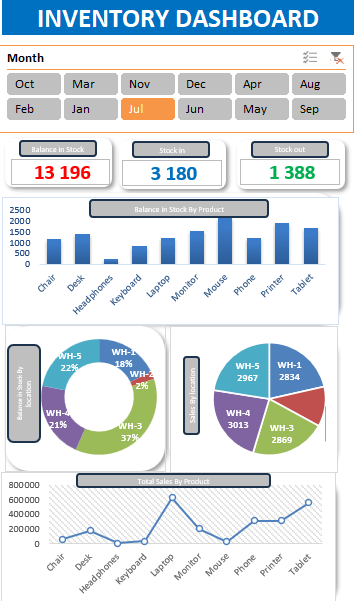

#  Inventory Dashboard — Tableau de bord de gestion des stocks

## Présentation du projet

**Inventory Dashboard** est un projet d'analyse et de visualisation des données réalisé avec **Microsoft Excel**. Il permet de suivre les mouvements de stock et les ventes de différents produits à travers un tableau de bord synthétique et interactif.

Le classeur contient une base de **500 enregistrements** dans l'onglet `Inventory Data`, ainsi qu'un onglet `Dashboard` et une feuille de synthèse.

##  Objectifs

- Visualiser rapidement l'état des stocks et les flux d'entrée et de sortie.
- Comparer les niveaux de stock selon les produits et les entrepôts.
- Analyser les ventes par produit, en dirhams marocains (MAD).
- Filtrer les résultats par mois pour faciliter le suivi.
- Transformer des données brutes en indicateurs utiles à la prise de décision.

##  Outils et fonctionnalités utilisés

- **Microsoft Excel** : préparation, organisation et analyse des données.
- **Tableaux croisés dynamiques (TCD)** : agrégation des stocks et des ventes.
- **Graphiques Excel** : histogramme, graphiques en anneau et courbe de ventes.
- **Segments (Slicers)** : filtre interactif par mois.
- **Mise en forme du tableau de bord** : cartes KPI, couleurs et disposition des graphiques.

##  Indicateurs et visualisations

Le tableau de bord présente notamment :

| Élément | Utilité |
|---|---|
| Balance in Stock | Afficher le solde de stock selon les données filtrées. |
| Stock In | Suivre les quantités entrantes. |
| Stock Out | Suivre les quantités sortantes. |
| Balance in Stock By Product | Comparer le stock disponible entre produits. |
| Balance in Stock By Location | Répartir le stock par entrepôt. |
| Stock In By Location | Visualiser les entrées de stock par entrepôt. |
| Total Sales By Product | Comparer les ventes par produit, en MAD. |
| Filtre Month | Explorer les indicateurs pour les mois sélectionnés. |

**Produits analysés :** Chair, Desk, Headphones, Keyboard, Laptop, Monitor, Mouse, Phone, Printer et Tablet.

**Données disponibles :** identifiant, date, mois, produit, stock initial, entrées, sorties, stock final, entrepôt, coût unitaire, ventes totales, seuil de réapprovisionnement et fournisseur.

##  Aperçu du tableau de bord

##  Fichiers du projet

- `inventory_sales_project_dataset(1).xlsx` : classeur Excel contenant les données et le tableau de bord.
- `Dashboard-preview.png` : capture d'écran du tableau de bord.
- `README_Inventory_Dashboard.md` : documentation du projet.

##  Comment utiliser le projet ?

1. Télécharger le classeur Excel.
2. Ouvrir le fichier dans une version de Microsoft Excel compatible avec les segments et les tableaux croisés dynamiques.
3. Accéder à l'onglet **Dashboard**.
4. Utiliser le filtre **Month** pour explorer les résultats.
5. Consulter l'onglet **Inventory Data** pour examiner les données sources.

##  Compétences mises en pratique

**Analyse de données · Microsoft Excel · Tableaux croisés dynamiques · Data Visualization · Gestion des stocks · Reporting KPI**

##  Améliorations possibles

- Ajouter des alertes lorsque le stock passe sous le seuil de réapprovisionnement.
- Intégrer une analyse de rotation des stocks.
- Automatiser l'actualisation du tableau de bord lors de l'ajout de nouvelles données.
- Développer une version complémentaire avec Power BI.

---

Projet pédagogique de visualisation et d'analyse des stocks sous Excel.    9ad lia had text fwahd lfichier word ykoon professionel
